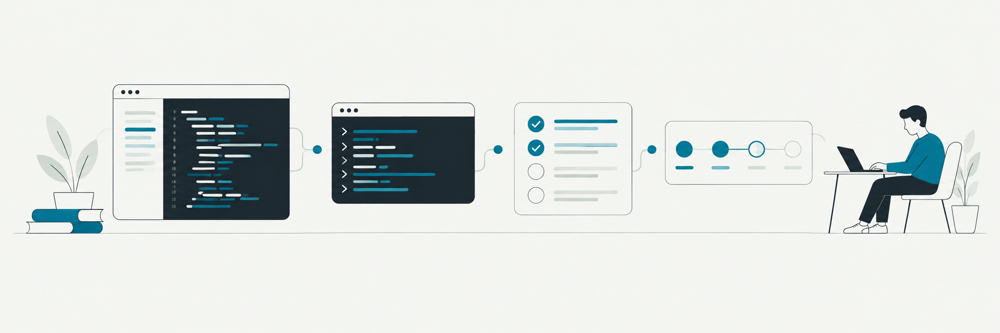

# Gopath

A local, single-user web app for learning Go by reading short lessons, answering questions, and running code on your own machine. Gopath binds to `127.0.0.1`, uses your installed Go toolchain, and does not send your code to a remote playground.

> **Project status:** This is an early working draft. The app, runner, progress flow, and full course outline are present. Most coding exercises are still generic arithmetic practice, and the seven projects do not yet implement their named programs. See [What is complete](#what-is-complete) before treating this as a finished Go course.

## Quick start

You need Go **1.22 or newer**, Node.js **20 or newer**, and npm. Install Go from [go.dev/dl](https://go.dev/dl) if `go version` is not available.

```sh
git clone https://github.com/cneuralnetwork/gopath.git
cd gopath
cd web && npm install && npm run build
cd ..
make run
```

The app opens at [http://127.0.0.1:7777](http://127.0.0.1:7777). If a browser does not open automatically, visit that address yourself. Gopath shows an installation page if Go is missing.

To build one executable that serves the bundled frontend:

```sh
make build
./gopath --no-browser
```

The executable still needs Go on `PATH` to run your practice code. Node.js is only needed to rebuild the frontend.

## Learn and practice

1. Choose a concept in the left rail. Complete its quiz and coding exercises to unlock the next concept. **Unlock everything** lets you browse ahead.
2. Read the lesson on the left. The right pane has **Code**, **Quiz**, and **Read** tabs.
3. In Code, edit the starter, select **Run** for `go run .`, or **Test** for `go test -json -count=1 ./...`. Test results include individual visible and hidden test names. Hidden test source is not shown.
4. Open **Tests** above the editor to read the visible test file. Use **Show hint** for progressive hints; **Show solution** asks for confirmation.
5. Code saves one second after you stop typing. **Reset** asks for confirmation before replacing your work with the starter.

Keyboard shortcuts:

| Action | Shortcut |
| --- | --- |
| Run code | `⌘/Ctrl+Enter` |
| Test code | `⌘/Ctrl+Shift+Enter` |
| Search | `⌘/Ctrl+K` |
| Insert a tab in the editor | `Tab` |

**Open in my editor** writes the current exercise and visible tests to `~/gopath-workspace/<concept>/<exercise>/`. Edit those files with your usual tools, then choose **Sync from disk** in Gopath. Progress is stored in `~/.gopath-learn/progress.json`; you can also export or import a JSON backup in the app.

## Development

Run the Go server and Vite separately for frontend work:

```sh
make run
make dev
```

Vite serves on `127.0.0.1:5173` and proxies `/api` to the Go server on port 7777. Server flags include `--port`, `--data-dir`, and `--no-browser`:

```sh
go run ./cmd/gopath --port 7778 --data-dir ./local-progress --no-browser
```

Checks:

```sh
make test
make verify-content
make lint
make build
```

`make test` tests the app packages. The course contains intentionally failing starter implementations, so its source files are checked separately by `make verify-content`. That verifier validates content metadata, runs each starter, expects its tests to fail, and checks that each reference solution passes. It can take several minutes on a cold Go build cache.

## Repository map

| Path | Purpose |
| --- | --- |
| `cmd/gopath` | Local HTTP server and startup flags |
| `cmd/verify` | Curriculum verification command |
| `internal/content` | Content loader and validation |
| `internal/runner` | Isolated temporary modules, process limits, test JSON parsing |
| `internal/store` | Atomic JSON progress storage |
| `internal/server` | JSON API and routes |
| `web` | React, TypeScript, Vite, and CodeMirror frontend |
| `content` | File-based lessons, quizzes, cards, exercises, and milestones |
| `DECISIONS.md` | Implementation assumptions and tradeoffs |

The `.yaml` metadata files use JSON syntax, which is a YAML 1.2 subset. To add a concept, create its `lesson.md`, `quiz.yaml`, `cards.yaml`, and exercise folders, then add it to `content/course.yaml`. Each exercise needs a compiling starter, a reference solution, and `visible_test.go` and `hidden_test.go`. Run `make verify-content` after editing content.

## Local execution and privacy

Gopath listens only on `127.0.0.1`. There is no account system or authentication. Each run copies source and tests into a fresh directory under your OS temporary directory, creates a `go.mod`, runs Go with a timeout and a 64 KB output cap, then removes the directory. The runner disables module downloads with `GOPROXY=off` and sets `GOTOOLCHAIN=local` and `CGO_ENABLED=0`. This is a local convenience boundary, not a sandbox for untrusted code: code you type can still access your files and network with your user account's permissions.

## What is complete

- Six chapters and 34 concept entries, with 136 MCQs, 68 exercises, and 204 visible plus 204 hidden exercise tests.
- Seven named projects with three milestones each, adding 126 milestone tests. The milestones use two source files in the editor.
- A working lesson and practice interface, quiz checking, progress and unlocking, test output, hints, solution confirmation, search, themes, export/import, and editor sync.
- An embedded frontend build and a Go server with tests for the loader, runner, store, and HTTP handler.

**Content limitations:** lesson text and quiz distractors still need topic-specific editorial review. The exercise set uses repeated arithmetic transformations, and the named projects use those transformations rather than word counting, ledgers, crawling, HTTP APIs, or job queues. SQLite and `react-markdown` are replaced by an atomic JSON store and a vendored Markdown parser. Review mode lists missed questions but does not yet schedule them by spaced repetition. This repository should be treated as a foundation for the requested course, not as the finished curriculum.
